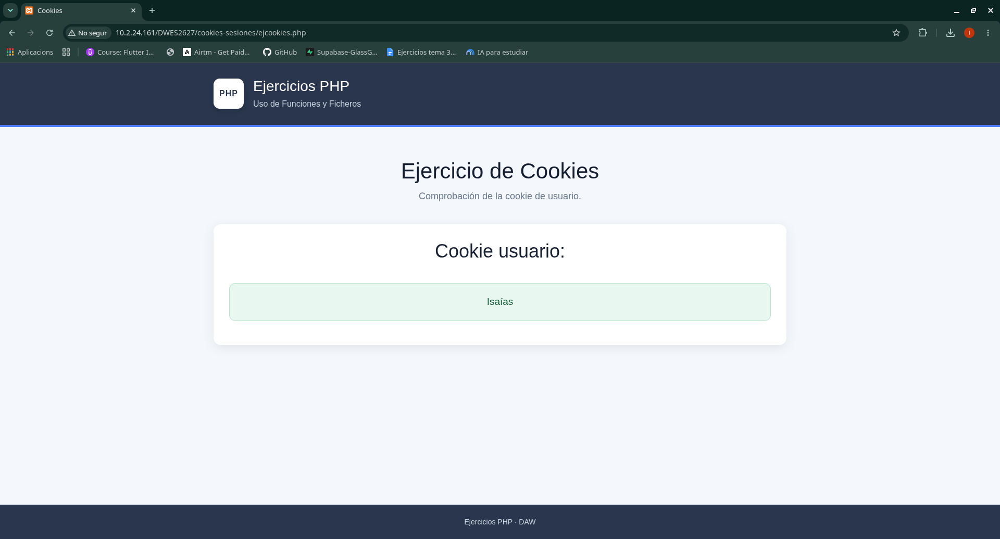
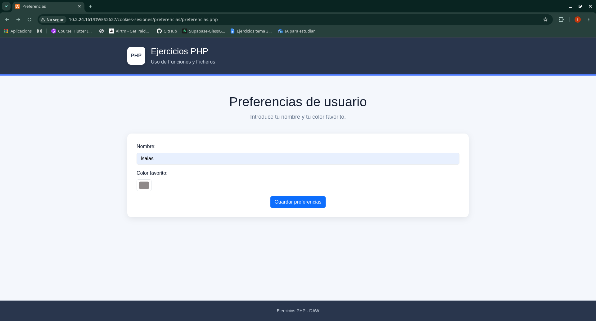
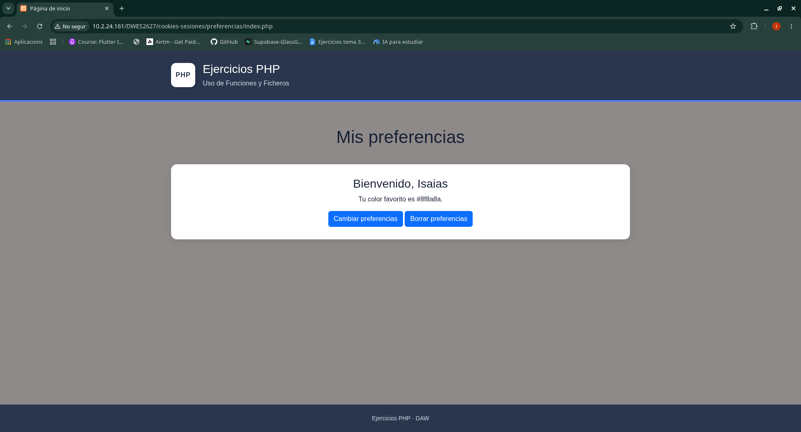
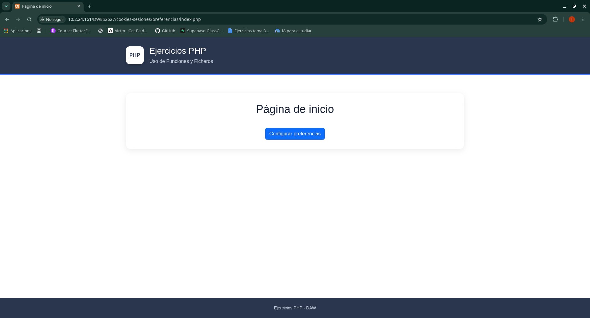
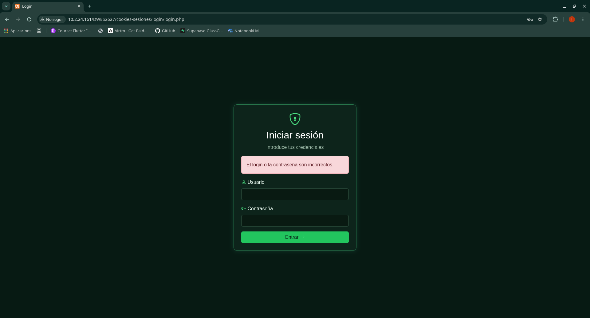
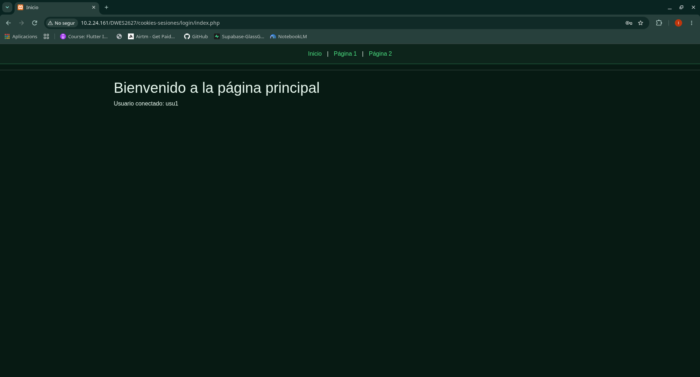
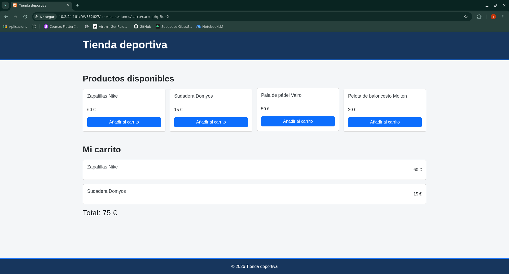

# Ejercicios - Cookies y Sesiones

Ejercicios realizados durante el apartado de **Cookies y Sesiones** de la asignatura Desarrollo Web en Entorno Servidor (DWES).

---

## Ejercicio - Cookies

### Enunciado

Realizar una aplicación que compruebe si existe la cookie `user` y tiene datos, vuestro nombre. En caso de estar vacía, que la cree con una caducidad de 1000.

En la siguiente ejecución debe de aparecer vuestro nombre en el navegador.

### Resultado

---

## Ejercicio - Preferencias

### Enunciado

Crea un formulario en `preferencias.php` que le pida al usuario su nombre y su color favorito (a elegir de una lista desplegable o con el control `input type="color"` de HTML5).

El formulario deberá enviarse a `guarda_prefs.php`. Esta página redirigirá (con `header()`) a la página `index.php` una vez almacenadas las cookies.

`index.php`, si hay cookies guardadas del usuario, mostrará una página con el color de fondo preferido y un mensaje personalizado de bienvenida (por ejemplo, «Bienvenido, Pepe»). Si no hay cookies guardadas, mostrará una página con fondo blanco y el mensaje «Página de inicio».

En cualquiera de los dos casos, habrá un enlace para ir al formulario `preferencias.php`.

Añade una página `borrar_prefs.php` que elimine las preferencias (cookies) del usuario actual y redirija a `index.php`. Añade un enlace «Borrar preferencias» en `index.php` que se muestre únicamente cuando el usuario tenga preferencias guardadas.

### Resultado

---

## Ejercicio : Calificaciones

### Enunciado

Crear una aplicación PHP para gestionar las calificaciones de los alumnos durante los tres trimestres del curso.

La aplicación debe permitir:

- Mostrar una lista de alumnos con sus notas del primer, segundo y tercer trimestre.
- Calcular y mostrar la media de las tres notas de cada alumno.
- Añadir nuevos alumnos mediante un formulario, introduciendo su nombre y las notas de los tres trimestres.
- Validar que las notas estén comprendidas entre 0 y 10.
- Guardar la lista de alumnos en una sesión para conservar los datos.
- Borrar todos los alumnos mediante un botón.

### Resultado

**1. Listado inicial de alumnos**

**2. Añadir un alumno**

**3. Borrar todos los datos**

---

## Ejercicio - Login y Sesiones

### Enunciado

Crear un pequeño sistema de login y uso de sesiones en PHP.

El fichero `usuarios.txt` almacena varios usuarios y contraseñas separados por dos puntos (`:`), uno por fila.

El archivo `cabecera.inc` comprueba si existe el atributo `loginusu` en la sesión. Si no existe, redirige a `login.php`. Si existe, muestra un menú con enlaces a `pag1.php` y `pag2.php`.

Las páginas `index.php`, `pag1.php` y `pag2.php` incluyen `cabecera.inc` mediante `require` y muestran mensajes de bienvenida diferentes.

Por último, `login.php` contiene el formulario de inicio de sesión y comprueba las credenciales introducidas con los datos de `usuarios.txt`. Si coinciden, guarda el nombre del usuario en la sesión y redirige a `index.php`. Si no coinciden, muestra un mensaje de error en rojo.

### Resultado

**1. Inicio de sesión con credenciales incorrectas**

**2. Página principal con sesión iniciada**

---

## Ejercicio - Carrito de la compra

### Enunciado

Crear una aplicación PHP que simule el funcionamiento de un carrito de la compra de una tienda deportiva.

La aplicación debe permitir:

- Mostrar una lista de cuatro productos deportivos con su nombre y precio.
- Añadir productos al carrito mediante enlaces.
- Guardar los productos seleccionados en una sesión para conservar el carrito.
- Mostrar los productos seleccionados en el carrito.
- Calcular y mostrar el precio total de los productos añadidos.

La presentación de la página se realizará mediante HTML, Bootstrap y una hoja de estilos CSS propia.

### Resultado

