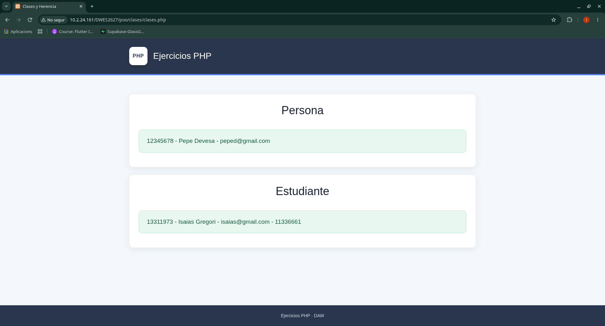
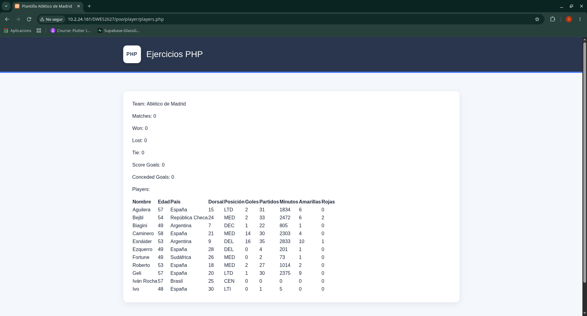

# Ejercicios - Programación Orientada a Objetos

Ejercicios realizados durante el apartado de **Programación Orientada a Objetos** de la asignatura Desarrollo Web en Entorno Servidor (DWES).

---

## Ejercicio - Clases y Herencia

### Enunciado

Crear una aplicación PHP utilizando programación orientada a objetos.

La aplicación debe permitir:

- Crear una clase `Persona` con los atributos DNI, nombre y email.
- Definir un constructor para inicializar los atributos.
- Utilizar atributos privados y crear sus correspondientes getters y setters para acceder a ellos.
- Crear un método `Mostrar()` que muestre los datos de la persona separados por guiones.
- Crear una clase `Estudiante` que herede de `Persona` y añada el atributo número de expediente.
- Definir el constructor, getter, setter y método `Mostrar()` de la clase `Estudiante`, reutilizando los datos de la clase padre.
- Crear un objeto de cada clase, modificar uno de sus atributos mediante un setter y mostrar sus datos en la página web.

Las clases se organizan en archivos independientes siguiendo las buenas prácticas de programación orientada a objetos.

### Resultado

---

## Ejercicio - Clases y Gestión de Objetos

### Enunciado

Crear una aplicación PHP utilizando programación orientada a objetos.

La aplicación debe permitir:

- Crear una clase `Player` con los atributos nombre, fecha de nacimiento, país, dorsal, posición, goles, partidos, minutos, tarjetas amarillas y tarjetas rojas.
- Definir un constructor para inicializar los datos principales del jugador.
- Utilizar atributos privados y crear sus correspondientes getters y setters.
- Implementar los métodos `Age()`, `Score()`, `AddCard(int Colour)`, `PlayMinutes(int min)` y `Render()` para gestionar y mostrar los datos del jugador.
- Crear una clase `Team` con los atributos nombre, jugadores, partidos, victorias, derrotas, empates, goles marcados y goles encajados.
- Definir un constructor, getters y setters para gestionar los datos del equipo.
- Implementar el método `SignPlayer(Player)` para añadir jugadores al equipo, evitando duplicados.
- Implementar el método `Render()` para mostrar las estadísticas del equipo y su plantilla, reutilizando el método `Render()` de la clase `Player`.
- Importar el archivo `plantillas.csv`, filtrar los jugadores del Atlético de Madrid y crear los correspondientes objetos `Player`.
- Crear el objeto `Team` con los jugadores obtenidos del CSV y mostrar la plantilla en la página web.

Las clases se organizan en archivos independientes y se utiliza un archivo CSV para cargar los datos de los jugadores.

### Resultado

---