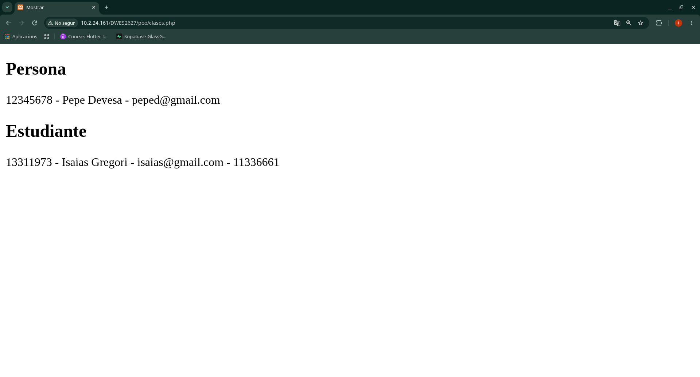

# Ejercicios - Programación Orientada a Objetos

Ejercicios realizados durante el apartado de **Programación Orientada a Objetos** de la asignatura Desarrollo Web en Entorno Servidor (DWES).

---

## Ejercicio - Clases y Herencia

### Enunciado

Crear una aplicación PHP utilizando programación orientada a objetos.

La aplicación debe permitir:

- Crear una clase `Persona` con los atributos DNI, nombre y email.
- Definir un constructor para inicializar los atributos.
- Utilizar atributos privados y crear sus correspondientes getters y setters para acceder a ellos.
- Crear un método `Mostrar()` que muestre los datos de la persona separados por guiones.
- Crear una clase `Estudiante` que herede de `Persona` y añada el atributo número de expediente.
- Definir el constructor, getter, setter y método `Mostrar()` de la clase `Estudiante`, reutilizando los datos de la clase padre.
- Crear un objeto de cada clase, modificar uno de sus atributos mediante un setter y mostrar sus datos en la página web.

Las clases se organizan en archivos independientes siguiendo las buenas prácticas de programación orientada a objetos.

### Resultado

---